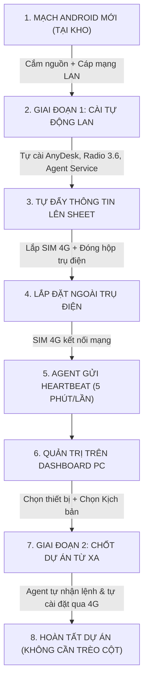

# QUY TRÌNH VẬN HÀNH CHUẨN (SOP)
## QUẢN LÝ THIẾT BỊ TRUYỀN THANH THÔNG MINH (TỪ MẠCH MỚI ĐẾN NGOÀI TRỤ ĐIỆN)

---

## 🧭 TỔNG QUAN VÒNG ĐỜI THIẾT BỊ



---

## BƯỚC 1: CHUẨN BỊ TẠI KHO / BÀN KỸ THUẬT

1. **Chuẩn bị các file APK** đặt cùng thư mục với phần mềm PC (`d:\Code\AndroidProject`):
   - `00_AutoSetup.apk` *(Lấy từ file thành phẩm `d:\Code\AutoSetup\app\build\outputs\apk\debug\app-debug.apk` đổi tên qua)*
   - `02_anydesk.apk`
   - `03_adcontrol-aosp.apk`
   - `04_Audio_3.6_productionRelease.apk`
   - `radio.apk` *(bản 1.66)*
   - `ics-android-box (2.0.0).apk`
   - `anydesk_config/` *(Thư mục mẫu mật khẩu nếu có)*
2. **Cắm thiết bị:**
   - Cấp nguồn cho Android Box.
   - Cắm dây mạng LAN từ Android Box vào chung Switch/Modem với máy tính của bạn.
   - Bật máy tính, mở terminal chạy:
     ```powershell
     cd d:\Code\AndroidProject
     python main.py
     ```

---

## BƯỚC 2: GIAI ĐOẠN 1 — CÀI ĐẶT TỰ ĐỘNG QUA LAN (TAB 1)

1. Trên phần mềm PC, chọn Tab **`📡 01 // GĐ1 - CÀI TẠI KHO (LAN)`**.
2. Kiểm tra ô **`SUBNET_LAN`** (phần mềm đã tự điền dải mạng, ví dụ `192.168.1`).
3. Chọn 1 trong 2 chế độ làm việc:
   - **Chế độ 1 — Tự động hoàn toàn (Khuyên dùng khi làm nhiều box):**
     - Bấm nút **`[ 🔁 01 // AUTO DÒ & CÀI: ON ]`**.
     - Cứ cắm mạch mới vào mạng LAN, phần mềm sẽ tự quét thấy, tự đẩy 4 file APK sang, tự cấp quyền Root & Accessibility, tự đặt mật khẩu AnyDesk `12345678j`, tự đổi giờ GMT+7 Bangkok và tự đăng nhập tài khoản test Radio 3.6 (`z755-01 / 2`) để loa phát tiếng test âm thanh.
   - **Chế độ 2 — Kiểm tra thủ công:**
     - Bấm **`[ 📡 02 // CHỈ AUTO DÒ: ON ]`** -> Khi box xuất hiện trên bảng, bạn tích dấu `[X]` rồi bấm **`[ 🚀 03 // CÀI MẠCH ĐÃ CHỌN ]`**.
4. **Kết quả đạt được của Giai đoạn 1:**
   - Dòng trạng thái trên bảng báo: `🎉 [PWNED_OK] HOÀN TẤT GĐ1!`.
   - AnyDesk ID và địa chỉ MAC (viết hoa toàn bộ, không có dấu `:`, ví dụ `C44F331A2B8C`) tự động được lưu vào file CSV và đẩy thẳng lên Google Sheet.
   - Dịch vụ **SGL Agent Service** đã được kích hoạt chạy ngầm vĩnh viễn trên box.

---

## BƯỚC 3: XUẤT XƯỞNG & LẮP ĐẶT NGOÀI TRỤ ĐIỆN

1. Rút dây mạng LAN khỏi box.
2. Lắp **SIM 4G** vào khay SIM của Android Box (hoặc cắm USB Dcom 4G).
3. Đóng nắp hộp kỹ thuật chống nước và bàn giao cho đội thi công treo lên trụ điện.
4. Khi thợ điện đóng cầu dao cấp điện ngoài trụ:
   - Android Box khởi động lên.
   - `BootReceiver` trên Android tự động kích hoạt **AgentService** chạy nền ngay khi vừa bật nguồn mà không cần ai đăng nhập.
   - Box tự kết nối mạng qua SIM 4G và bắt đầu chu kỳ gửi nhịp tim (Heartbeat) **5 phút/lần** về Google Sheet.

---

## BƯỚC 4: GIÁM SÁT THỰC ĐỊA TRÊN DASHBOARD (TAB 2)

Bạn ngồi tại văn phòng quản lý thiết bị ngoài thực địa:
1. Mở phần mềm PC, chuyển sang Tab **`🖥️ 02 // DASHBOARD - THỰC ĐỊA`**.
2. Box vừa lắp ngoài trụ điện sẽ tự động xuất hiện trên bảng:
   - Đèn hiệu: 🟢 **Online** (Báo hiệu nhịp tim vừa gửi dưới 10 phút).
   - Hiển thị đầy đủ: **MAC Address**, **AnyDesk ID**, **Dự án**, **App Version**, **Dung lượng trống (MB)** và **Thời gian ping cuối**.
3. **Khi cần truy cập khẩn cấp bằng AnyDesk:**
   - Nhấp chuột phải vào dòng thiết bị -> Chọn **`Mở AnyDesk`** (phần mềm tự bật AnyDesk trên máy tính và kết nối thẳng với mật khẩu `12345678j`).
   - Hoặc bấm nút **`[ 📋 SAO CHÉP ANYDESK ]`** để gửi mã cho đồng nghiệp.

---

## BƯỚC 5: GIAI ĐOẠN 2 — CHỐT DỰ ÁN TỪ XA HÀNG LOẠT (TAB 3)

> [!IMPORTANT]
> **Điểm đột phá:** Bạn **không cần** ngồi mở AnyDesk vào từng con để click tay, và **không cần** trèo lên trụ điện. Mọi thao tác đổi app được thực hiện tự động qua mạng 4G.

Giả sử cấp trên yêu cầu: *"10 con box này thuộc dự án Radio 1.66, 20 con kia thuộc dự án VNPT ICS, số còn lại giữ 3.6 nhưng đổi tài khoản"*:

1. Mở Tab **`🚀 03 // GĐ2 - CHỐT DỰ ÁN HÀNG LOẠT`**.
2. Bảng bên trái hiển thị danh sách toàn bộ box đang hoạt động:
   - Tích chọn `[X]` các box cần cài đặt (có nút **`[ ☑ CHỌN TẤT CẢ ]`** nếu làm toàn bộ).
3. Bên phải, tại mục **`CHỌN KỊCH BẢN DỰ ÁN (TEMPLATE)`**, chọn kịch bản mong muốn:
   - **`deploy_radio_166`**: Tự động gỡ bản 3.6 test -> Cài Radio 1.66 -> Cập nhật tên dự án trên Sheet thành `Radio 1.66`.
   - **`deploy_vnpt_ics`**: Tự động gỡ Radio -> Cài app VNPT ICS -> Tự động trích xuất mã thiết bị ICS -> Ghi lên Sheet.
   - Hoặc bất kỳ kịch bản nào bạn tạo mới.
4. Bấm nút màu cam: **`[ 🚀 BẮT ĐẦU TRIỂN KHAI CHO CÁC MẠCH ĐÃ CHỌN ]`**.
5. Xác nhận **Yes**:
   - Lệnh được ghi vào hàng đợi trên Google Sheet.
   - Khi các box ngoài trụ điện gửi nhịp tim trong vòng 5 phút tiếp theo, Agent trên box sẽ tự kéo lệnh về, tự thực thi ngầm và báo cáo hoàn tất.
   - Cột **Trạng thái Task** trên Dashboard sẽ tự động cập nhật tiến độ theo thời gian thực.

---

## BƯỚC 6: NÂNG CẤP CODE HOẶC TẠO TÁC VỤ BẤT KỲ TỪ XA (TAB 4)

Khi có một dự án mới phát sinh yêu cầu đặc biệt (ví dụ: *"Cần tải file APK 2.0 từ link Google Drive về, xóa app cũ, chạy lệnh cấu hình"*):

1. Vào Tab **`🛠️ 04 // TASK BUILDER`**.
2. Nhập tên kịch bản mới (ví dụ: `nang_cap_app_moi`) và mô tả.
3. Ở khung bên phải có danh sách các hành động có sẵn, bạn có thể bấm **`Chèn mẫu nhanh`**:
   ```json
   [
     {
       "action": "download_apk",
       "params": {
         "url": "https://server.cuaban.com/app_moi.apk",
         "save_as": "app_moi.apk"
       }
     },
     {
       "action": "install_apk",
       "params": {
         "file": "app_moi.apk"
       }
     },
     {
       "action": "uninstall_pkg",
       "params": {
         "package": "com.radiostation"
       }
     },
     {
       "action": "report_field",
       "params": {
         "field": "project",
         "value": "Dự án mới 2026"
       }
     }
   ]
   ```
4. Bấm **`[ 🔍 KIỂM TRA & FORMAT JSON ]`** để phần mềm kiểm tra không có lỗi dấu ngoặc.
5. Bấm **`[ 💾 LƯU KỊCH BẢN LÊN GOOGLE SHEET ]`**.
6. Quay lại **Tab 3**, chọn kịch bản `nang_cap_app_moi` vừa tạo và bấm **Triển khai** cho các thiết bị ngoài trụ điện.

---

## BẢNG XỬ LÝ SỰ CỐ NHANH (TROUBLESHOOTING)

| Hiện tượng | Nguyên nhân | Cách khắc phục |
| :--- | :--- | :--- |
| Box mới cắm LAN không hiện trên Tab 1 | Khác dải IP LAN hoặc chưa bật ADB trên box | Kiểm tra lại ô `SUBNET_LAN` (phải khớp với 3 số đầu của IP máy tính). Đảm bảo Android Box đã bật USB Debugging/Network ADB. |
| Dashboard hiện chấm đỏ 🔴 **Offline** | Hết tiền SIM 4G hoặc box bị mất điện trụ | Kiểm tra dung lượng/tài khoản SIM 4G; kiểm tra nguồn điện cấp tại trụ điện. |
| Triển khai GĐ2 mà box chưa nhận lệnh ngay | Chu kỳ nhịp tim định kỳ là 5 phút | Đợi tối đa 5 phút để box đến chu kỳ đồng bộ tiếp theo với Google Sheet. |
| Muốn can thiệp xử lý gấp ngay lập tức | Cần chỉnh thông số tức thời | Vào Tab 2, click chuột phải vào thiết bị -> Chọn **Mở AnyDesk** để điều khiển màn hình trực tiếp. |
